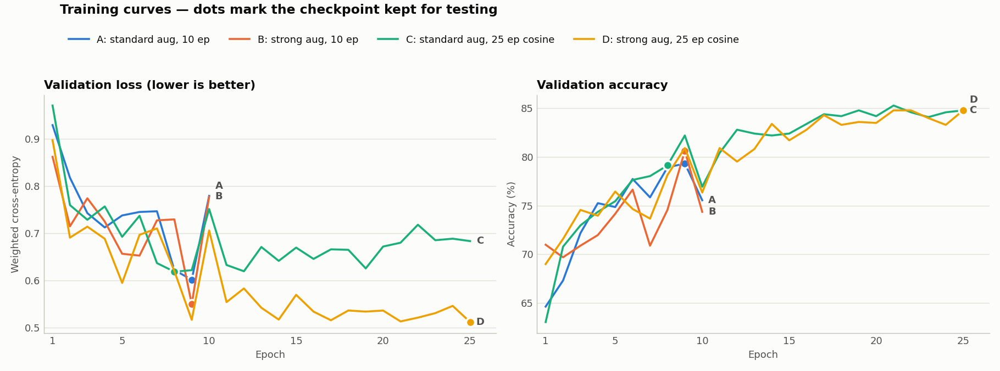

# Fine-tuning comparison: augmentation and training length

Four ResNet-18 fine-tuning runs on HAM10000, all scored on the same 1,035 test images that none of them saw during training.

**Verdict: run D (strong augmentation, 25 epochs, cosine learning-rate schedule) is the best model.** It has the highest accuracy (81.5%), macro F1 (0.686) and weighted F1 (0.819), and costs nothing extra at inference time. The price is about 2.5× more training time.

## What was compared

Everything except two factors was held constant:

- ImageNet-pretrained ResNet-18
- Adam, learning rate 1e-4, batch size 32
- class-weighted cross-entropy
- seed 42
- the same lesion-level 80/10/10 split

The two factors that changed:

| Run | Augmentation | Epochs | Learning-rate schedule |
|---|---|---|---|
| **A** | standard | 10 | constant |
| **B** | strong | 10 | constant |
| **C** | standard | 25 | cosine (1e-4 → 0) |
| **D** | strong | 25 | cosine (1e-4 → 0) |

- **Standard augmentation:** random crop (80–100% of the image), horizontal flip, ±20° rotation, mild colour jitter.
- **Strong augmentation:** random rotation at any angle, horizontal and vertical flips, wider crops (60–100%), slightly stronger colour jitter. Dermoscopy images have no natural "up" direction, so all of these keep the diagnosis the same.

Each run keeps the checkpoint with the lowest validation loss, and that checkpoint is the one tested.

## Results on the test set

| Run | Accuracy | Balanced accuracy | Macro F1 | Weighted F1 | Macro AUC | Epoch kept | Training time |
|---|---|---|---|---|---|---|---|
| A | 79.0% | 67.6% | 0.654 | 0.798 | 0.945 | 9 | 12.8 min |
| B | 76.8% | 69.6% | 0.647 | 0.785 | 0.953 | 9 | 30.4 min* |
| C | 74.7% | 66.5% | 0.618 | 0.766 | 0.940 | 8 | 29.7 min |
| **D** | **81.5%** | **69.9%** | **0.686** | **0.819** | **0.953** | 25 | 31.7 min |

\* Run B's time is inflated: the laptop was on battery for part of it, which throttled the GPU to about a third of its speed. On mains power it would have taken about 13 minutes, like A.

**Macro F1** is the most important column. It weights all 7 lesion classes equally, so a model can't score well just by getting the common nevus class right.

### Per-class F1

| Run | akiec | bcc | bkl | df | mel | nv | vasc |
|---|---|---|---|---|---|---|---|
| A | 0.575 | 0.725 | 0.680 | 0.412 | 0.541 | 0.892 | 0.750 |
| B | 0.564 | 0.755 | 0.639 | 0.462 | 0.502 | 0.882 | 0.727 |
| C | 0.519 | 0.676 | 0.692 | 0.375 | 0.476 | 0.859 | 0.727 |
| **D** | 0.553 | 0.750 | 0.688 | **0.581** | **0.570** | **0.912** | 0.750 |

D improves on A for five of the seven classes. The biggest gain is dermatofibroma (`df`), the rarest class, which goes from 0.41 to 0.58. D is slightly lower only on actinic keratosis (`akiec`).

### Are the differences real?

With 1,035 test images, small gaps can be luck. A paired bootstrap resamples the test set 2,000 times and recomputes each difference against run A:

| Run vs A | Accuracy difference (95% interval) | Macro F1 difference (95% interval) | Chance macro F1 is better |
|---|---|---|---|
| B | −4.5 to +0.1 points | −0.052 to +0.043 | 43% |
| C | **−6.7 to −2.0 points** | −0.080 to +0.007 | 5% |
| D | **+0.2 to +4.9 points** | −0.013 to +0.079 | **92%** |

- **D's accuracy gain is real:** its whole interval is above zero. Its macro F1 gain is very likely real (92%), but not certain.
- **C is genuinely worse than A** on accuracy.
- **B is indistinguishable from A.**

## Why the runs differ

**Longer training without stronger augmentation backfires (C).** In the right panel, C's validation accuracy keeps rising to about 85%. In the left panel, its validation loss bottoms out at epoch 8 and then creeps up. By the end, training accuracy reaches 98–99%: the model is memorising the training images. It becomes overconfident on the validation images it still gets wrong, and cross-entropy punishes confident mistakes heavily. Because the checkpoint is chosen by lowest validation loss, C keeps its epoch-8 weights. Those weights were taken while the learning rate was still high, before the model had settled, which is why C tests below A.

**Stronger augmentation needs time to pay off (B vs D).** Heavily augmented images are harder to fit, so after 10 epochs B is still under-trained, and it ends up level with A. Given 25 epochs (D), the same augmentation keeps the model from memorising. Training accuracy stays around 91%, and validation loss keeps falling until the very last epochs, reaching the lowest value of any run (0.511). For D, the lowest-loss checkpoint is also one of the most accurate.

**The cosine schedule makes late epochs settle.** With a constant learning rate, validation loss jumps between epochs; A and B both spike at epoch 10. The cosine schedule lowers the learning rate towards zero, so D's last ten epochs are stable, and the checkpoint is less a matter of luck.

## Cost (frugal-AI view)

- **Inference: no difference.** All four are the same ResNet-18 with the same 11.18 M parameters (42.7 MB). FLOPs, latency, throughput, memory and energy per image are identical, so the benchmarks in `evaluation.ipynb` apply to whichever checkpoint is deployed.
- **Training: D costs about 2.5× more than A** (31.7 vs 12.8 minutes on a GTX 1650). Training energy should scale roughly with that time. It wasn't measured with CodeCarbon, which currently tracks only test-set inference.

The extra training is a one-off cost. A model scores thousands of images over its life, so a 2.4-point accuracy gain for 19 extra minutes of training is a good trade.

## Recommendation

**Use run D** (`configs/strong_cosine25.yaml`, checkpoint `skin-lesion-classification/results/strong_cosine25_resnet18/best_model.pth`) as the default model.

One trade-off to be aware of: **D finds slightly fewer melanomas than A.** Melanoma recall is 65.7% vs 69.7%: 65 of 99 test melanomas caught, against 69. Melanoma precision and F1 are higher, so D makes fewer false melanoma alarms. If missing a melanoma is the costliest error in your use case, its decision threshold could be tuned to trade some precision back for recall.

## Caveats and next steps

- **One run per setup.** Each configuration was trained once with seed 42. Repeating each with 2–3 more seeds would show how much of each gap comes from random variation.
- **Choose checkpoints by macro F1, not loss.** Run C shows that the lowest-loss checkpoint can be far from the most accurate one. Selecting by validation macro F1 would match the metric being reported.
- **Measure training energy.** Wrapping the training loop in a CodeCarbon tracker would put the training cost in the same units (kWh, CO₂e) as the inference benchmarks.

Raw numbers: `skin-lesion-classification/results/comparison.json`. Per-run training logs and Grad-CAM maps: `skin-lesion-classification/results/<run>/`.
